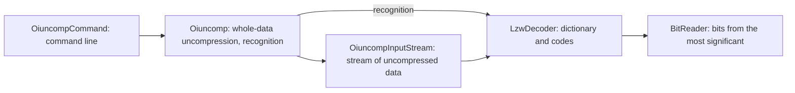

# 0001. Compression format of Oracle Installer and a strict decoder

[Русская версия](0001-oicomp-format_ru.md)

## Context

Oracle 7.3 distributions for Unix contain files compressed by Oracle Installer: an underscore `_` is appended to the
name of a compressed file. They are uncompressed by the `oiuncomp` utility of the `orainst` directory of the
distribution. It exists only as executables for the Unix platforms of that time, and the compression format is
undocumented.

The format has no signature, no length of the original data and no checksum. So a corrupted or truncated file can be
detected only by violations in the stream of codes itself.

## Decision

The format is described below and implemented by a decoder in Java.

| Element          | Layout                                                                                          |
|------------------|-------------------------------------------------------------------------------------------------|
| Header           | the first byte is the maximum code width; Oracle Installer writes 14                            |
| Codes            | packed without alignment, from the most significant bit of a byte; 9 bits wide at first         |
| Literals         | codes 2–257 stand for bytes 0–255 (byte + 2)                                                    |
| Reset            | code 1: the dictionary returns to its initial state, the code width to 9 bits                   |
| Code 0           | not used                                                                                        |
| Dictionary       | entries from 258; an entry is the previous code's string plus the first byte of the current one |
| Width growth     | after the entry 2^n − 1 (511, 1023, …) is added, the code width grows by a bit                  |
| Dictionary limit | entries are added while the new number is below 2^max − 1; then the compressor emits a reset    |
| End              | no marker: the stream ends when fewer bits than the code width are left                         |
| Padding          | the last byte is padded with zero bits                                                          |

The decompressor adds an entry to the dictionary a step later than the compressor, after the next code. So the
compressor may emit the code of an entry that the decompressor has not added yet: it is exactly the next dictionary
number, and its string is the string of the previous code followed by its first byte.

The decoder is stricter than the Oracle decompressor. The following is corrupted data (`OiuncompException`):

- empty data and a maximum code width outside 9–16;
- a first code after the header or a reset that is not a literal, including a reset right after a reset;
- code 0 and a code greater than the next dictionary number, and on a full dictionary the next number itself;
- a rest of the data after the last code of 8 bits or more, or with non-zero bits.

The format has no signature: the first byte is a parameter (the maximum code width), the second one holds the high
bits of the first code, that is the first byte of the original data plus 2. So `Oiuncomp.isCompressed` recognizes
compressed data by a trial uncompression: the strict decoder checks the header and the first 64 codes, or all the
codes and the padding of shorter data. At least one code is required: the Oracle compressor fails on empty data.

Components:

`LzwDecoder` and `BitReader` are not visible outside the package. The public API is `OiuncompInputStream`,
`Oiuncomp`, `OiuncompException` and the utility `OiuncompCommand`.

## Rationale

- The description of the format was reconstructed from the code of the decompressor and the compressor of Oracle
  Installer (module `oilz.c`, functions `oilzdc` and `oilzec`). It is verified by a reference compressor written from
  this description: it reproduces the compressed files of the Oracle 7.3 distribution byte for byte, including a file
  with a dictionary reset. The uncompressed text matches the published texts of the same scripts of the same period,
  up to the changes between versions.
- A valid compressor never emits the codes that the decoder takes for errors. Checking these codes and the padding is
  the only way to notice a format violation without a checksum.
- The Oracle decompressor stops when the output buffer is full and continues on the next call. In Java an
  `InputStream` solves the same task: the decoder produces the string of the next code, and the stream hands it out on
  demand.
- The string of a code is built along the prefix chain from the end of the buffer, so it need not be reversed. The
  prefix of an entry is always less than its number, so the chain is guaranteed to end with a literal.
- A code of foreign data is valid for the strict decoder with a probability of about 1/2, so 64 codes reject foreign
  data with a large margin, while recognition reads only the start of a file. There are no false positives on the
  files of the Oracle 7.3 distribution, script texts, executables and jar archives.

## Alternatives

- **A lenient decoder, like Oracle's.** The Oracle decompressor takes any code greater than the last dictionary number
  for "the next entry" and reads unfilled dictionary entries. On corrupted data this produces garbage without an
  error.
- **Porting the state machine of the Oracle decompressor that suspends by output size.** The suspension state is
  needed only when data is pushed into a buffer of the caller; reading a stream makes it unnecessary.
- **Running the original utility.** It needs an old Unix platform or its emulation, which is not practical on current
  systems.
- **Recognition by the first byte.** The byte 14 is the value of a parameter, not a marker, and a valid header 9–16
  occurs, for example, in a text that starts with a tab or a line feed.

## Consequences

- Truncation of a file exactly at a code boundary cannot be detected: the format does not store the length.
- The compressed data must extend to the end of the source. A stream in which other data follows the compressed data
  is not supported: the format gives no way to find its boundary.
- The maximum code width of the header is limited to 9–16. The Oracle decompressor also accepts values below 9,
  taking them for 9; in the known files of the distribution the header is always 14.
- The memory of the decoder is a dictionary of up to 65,535 entries and a string buffer: about 384 KiB for width 16
  and 96 KiB for width 14.
- The test data is synthetic. The reference compressor of the tests pins the format: the round trips cover the growth
  of the code width, the dictionary reset and the codes of entries that the decompressor has not added yet.
- Real Oracle files are not part of the project. Checking them is local: `SampleFilesTest` with the property
  `oiuncomp.samples` (a file or a directory) requires each file to be recognized, uncompressed and restored by the
  reference compressor byte for byte.
- A header without codes is uncompressed into empty data but is not recognized as compressed.
